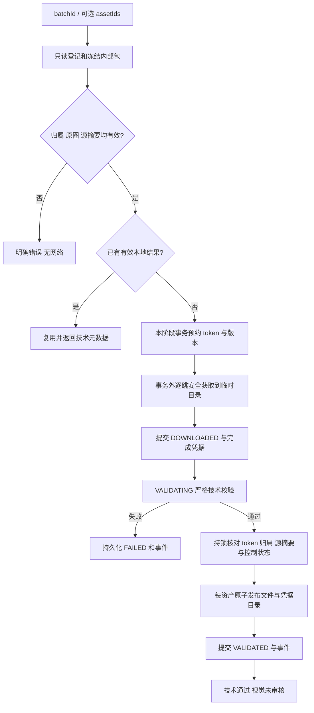
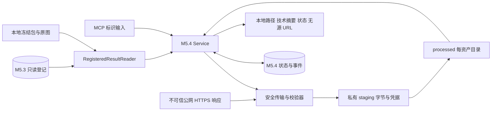
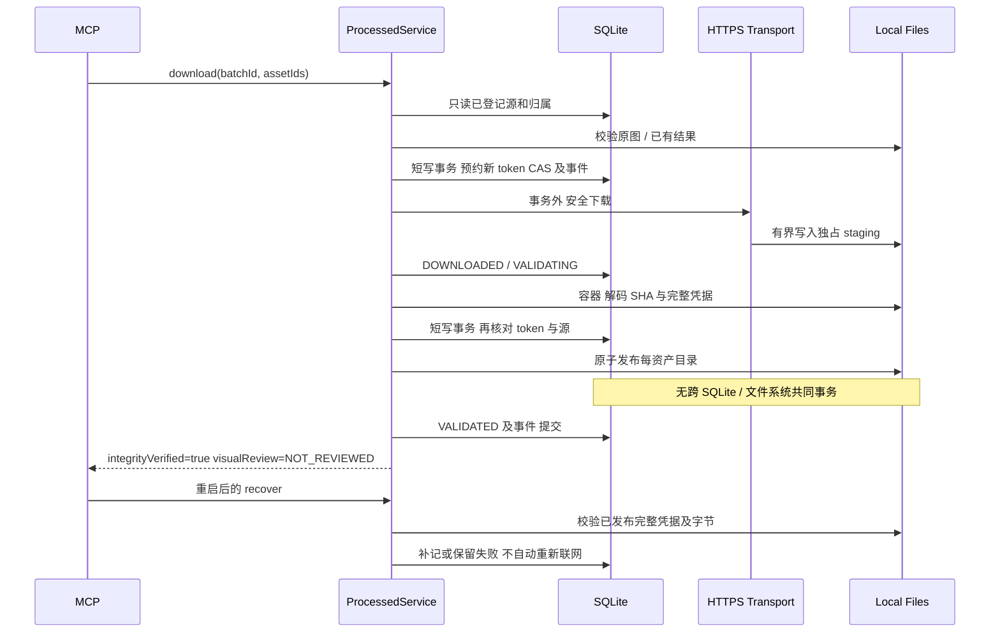
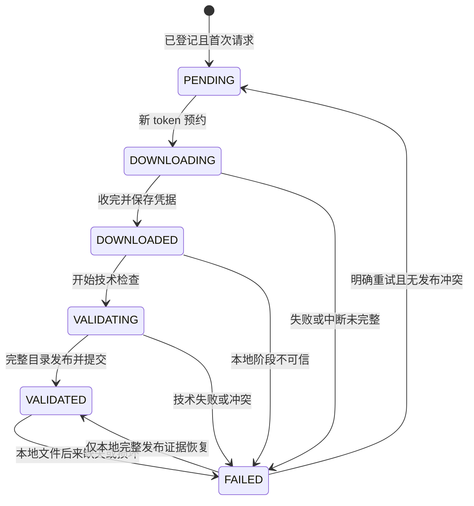

# M5.4 结果下载与完整性校验技术方案

状态：**已批准并实施，代码与技术测试完成**。规划基线 `68064ae`；2026-11-08。真实 Muse 输出验收按用户选择待补，当前范围与结果见 M5.4-test-report.md。本文保留方案及实际兼容调整。

后续状态：用户已明确批准实施，并接受真实 Muse 验收待补。已按本方案开发，实际记录见 M5.4-test-report.md。为保留审批依据，原方案文字不改写为历史上已完成；以下实施差异优先描述当前行为：

- Windows 实测双层 assetId 目录使路径超过常见外部程序限额。父目录改为冻结批次内短序号 `processed/A1`–`A4`，文件名、receipt、数据库身份仍为完整 assetId，唯一关联不变；这不是重分配。
- 每进程最多 2 个工作位；数据库写锁内也限制最多 2 个未过期活跃租期。不能据此声称能够强杀其他进程已失效但尚未退出的解码线程。
- 升级前对任何已有项目库做一致 VACUUM INTO 备份（含 M5.3 之前的库），追加两表和索引使用独立 BEGIN IMMEDIATE/COMMIT；同时校验列、完整表约束和索引定义，不自动修补不兼容结构。
- 本地恢复可读取原已完整阶段；新 owner 先获得新 token，旧阶段原样保留，当前 token 的新阶段完整后才切换指针。读取旧完整字节不授予旧 worker 发布权。
- 初版不自动启动网络重试，不支持结果换 URL、HTTP Range、覆盖损坏成品、图像元数据重编码或视觉审核。

## 1. 背景与目标

M5.3 已把结果链接登记为 LINK_REGISTERED；它没有下载或验证结果。M5.4 将该登记转换为可追溯本地文件，并能在网络、进程及数据库失败后恢复。技术校验通过不证明图像语义、SKU 外观或优化质量正确，视觉状态固定为 NOT_REVIEWED。

范围是读取已登记结果、安全获取、技术校验、独立状态与事件、本地文件和进度。不包含 Muse 调用/网页、任务生成、上传/商品/草稿/发布、多模态视觉评审或 M5.5。

## 2. 现有架构与兼容事实

已阅读 M5.1、M5.2、M5.3 需求/设计/任务/报告及当前资产、引用、批次、MuseJobService/Mapper、MusePackageFiles、OriginalImageFetcher、SafeImageSource、MuseModels、RuntimeConfiguration、schema 和相关测试。

| 当前事实 | 对设计的约束 |
| --- | --- |
| ImageAsset 带完整原 URL 和 references，SKU 位于规格值字段 | 只读原身份，不能用新 URL 伪造另一份 ImageAsset |
| M5.2 get 会执行过期租期回收 | 新阶段不调用它来读取上下文，使用只读 Mapper |
| MuseJobService.results 会重建 result-links.json | M5.4 不通过该接口驱动自己的状态，直接只读登记和冻结包 |
| ms_muse_result 有复合主键(job_id,asset_id)、唯一 asset_id/url_hash | 可作为新增处理记录的外键父表；不能从工具输入引入源 URL |
| status=LINK_REGISTERED、download_verified CHECK=0 | 保留原表；新处理状态独立，旧查询继续保持原含义 |
| 旧包 inspect 依赖 v1 Prompt 和当前 VERSION | 不修改历史模板，安全交付使用独立投影方案 |
| 现有 safe resolver 固定已校验 IP；原图 fetcher 接受 ImageAsset | 复用安全策略，不直接给原图 fetcher 填结果 URL |
| Boot 通过 schema.sql 建表，没有现成迁移框架 | 首版只追加新表；后续字段演进须专门迁移，CREATE IF NOT EXISTS 不是通用迁移机制 |

## 3. 模块划分与复用选择

| 拟新增专用组件 | 职责及依赖 |
| --- | --- |
| MuseProcessedModels | 处理状态、内部源记录、技术元数据、结果与进度 DTO；不接收任意 URL/path |
| MuseRegisteredResultReader | 只读 MuseJobMapper、ImageBatchMapper、冻结 context/package；核对 batch/job/asset、源 url_hash、原图归属及摘要 |
| MuseProcessedResultMapper | 只写本阶段两表，CAS 状态更新、事件、进度 |
| MuseProcessedImageFetcher | 仅接受 reader 产生的内部 RegisteredResultSource；调用 SafeImageSource，每跳校验并固定 IP |
| MuseProcessedHttpTransport | 专用受限传输，保留 hostname/TLS；计数所有响应体，超限或不需要的体及时取消 |
| ProcessedImageValidator | MIME/签名/容器结构/真实解码/尺寸/摘要；不做视觉评判 |
| MuseProcessedFiles | 受控原图引用、staging、processed、凭据、摘要检查与原子发布，不改旧包文件 |
| MuseProcessedImageService | 单资产事务编排、预约、进度、重试、恢复；无外部任务队列 |
| MuseProcessedRecovery | 启动/明确恢复时只处理本阶段本地状态，不自动发起网络重试 |
| MuseProcessedImageTools | 标识输入接口、脱敏结果、无任意下载入口 |

推荐复用 SafeImageSource 原有 parse/resolve 地址策略和既有测试契约；先复核其策略覆盖，再复用。新传输需要更严格的字节统计/错误分类，保留在专用组件中，不强行修改 OriginalImageFetcher 的 API、错误码或 ImageAsset 语义。新校验器不改变旧原图校验行为。不提取或重构公共工具类，不引入外部依赖。确需改变旧组件的发现必须单独评审。

## 4. 已批准的初版资源预算

- 图片格式 JPEG/PNG；8 MiB/图；宽高各不超过 20000、总像素不超过 4000 万；未知格式明确拒绝。
- DNS 4 秒、连接 5 秒、响应 10 秒、单跳 20 秒，最多 3 次重定向；另设单资产网络总预算 120 秒，包含 DNS/重定向全过程，不能仅用“4 次单跳”冒充总预算。
- 全局工作并发上限建议 2，排队有界；批内最多 4 个已登记资产依次处理。超过容量返回 BUSY/QUEUE_FULL，不创建无限线程。
- 新阶段租期建议 300 秒，心跳只更新自己的行；使用 UTC 固定毫秒 ISO-8601。租期与人工等待、M5.2 的 1800 秒无关。
- 网络超时不包含不可中断解码的硬终止保证。限制字节、像素、队列/并发；调用方超时后保留工作位直到底层真的退出，不能另起无限线程。若要求强制 CPU 隔离，需要另批独立进程验证器方案。
- 所有文件位于用户受控根目录，禁止外部账号写入；原子移动失败时明确失败，不无声降级为非原子覆盖。

## 5. 核心业务流程



## 6. 数据流与信任边界



唯一可下载源是 reader 从 ms_muse_result 取出的准确 URL。result-links.json 是投影，不作为输入事实源；不读取外部 JSON 里的“替代下载链接”。事件/凭据不复制原 URL、签名参数或 SKU Key；本地原映射仍由固定内部包提供。新交付目录与 processed 缓存不是同一公开边界。

## 7. 正常与中断时序



## 8. 状态机、幂等与独立语义



NOT_STARTED、MISSING_LINK 是查询派生状态，不给未登记资产插入处理行。批次可部分成功，逐资产持久化；一张失败不回滚其他已完成文件。

每次所有权变化生成新的随机 token，attempt_no+1；显式网络重试才 retry_count+1。row_version 每次 CAS 更新递增。旧 token 无法续租或发布；超时只表示所有权失效，不证明旧进程已经停止。有效 VALIDATED 重复请求必须先检查文件，不能重复联网；新 URL 不被自动接受。M5.3 原字段继续 false，新 DTO 的 integrityVerified 仅来自本阶段检查，visualReviewStatus 永远 NOT_REVIEWED。

不同 assetId 的相同 SHA 不设置 UNIQUE：独立文件与行，给 DUPLICATE_CONTENT 提示，等待人工关联/视觉判断；这是 Q5 待批策略，不能用 SHA 证明 SKU 匹配。

## 9. 数据库设计：仅新增两表（实施 DDL）

以下批准 DDL 已追加到 schema.sql，并在隔离旧库和测试库完成升级验证；本次未升级用户正式业务库。不 ALTER、重建或回填 ms_muse_result，不改变其 CHECK=0。不增加迁移框架；升级前一致备份，结构/约束/索引不兼容则拒绝启动。后续改结构仍需专门迁移，不能只靠 IF NOT EXISTS。

```sql
BEGIN IMMEDIATE;
CREATE TABLE IF NOT EXISTS ms_muse_processed_result (
  job_id TEXT NOT NULL,                         -- M5.3 固定 job
  asset_id TEXT NOT NULL,                       -- 原 assetId，身份不重新计算
  source_url_hash TEXT NOT NULL CHECK(length(source_url_hash)=64), -- 登记表既有 url_hash，不存完整 URL
  original_sha256 TEXT NOT NULL CHECK(length(original_sha256)=64), -- 原图冻结摘要
  status TEXT NOT NULL CHECK(status IN
    ('PENDING','DOWNLOADING','DOWNLOADED','VALIDATING','VALIDATED','FAILED')), -- 独立技术状态
  row_version INTEGER NOT NULL DEFAULT 0 CHECK(row_version>=0),   -- 乐观并发版本
  attempt_no INTEGER NOT NULL DEFAULT 0 CHECK(attempt_no>=0),     -- 每次获得新所有权递增
  retry_count INTEGER NOT NULL DEFAULT 0 CHECK(retry_count>=0),   -- 明确网络重试次数
  attempt_token TEXT,                           -- 当前/最后尝试标识，旧尝试不得提交
  lease_until TEXT,                             -- 本阶段 UTC 固定毫秒期限
  staging_relative_path TEXT,                   -- 专用组件生成的私有相对目录
  processed_relative_path TEXT UNIQUE,          -- 根目录内唯一结果路径，非远程文件名
  http_status INTEGER CHECK(http_status BETWEEN 100 AND 599),     -- 最近有效 HTTP 状态，允许 NULL
  media_type TEXT,                              -- 通过白名单后的实际媒体类型
  actual_bytes INTEGER CHECK(actual_bytes>=0),   -- 实际落盘字节数，非信任 Content-Length
  width INTEGER CHECK(width>0),                 -- 实际解码宽度，允许 NULL
  height INTEGER CHECK(height>0),               -- 实际解码高度，允许 NULL
  processed_sha256 TEXT CHECK(length(processed_sha256)=64),       -- 完整结果文件摘要
  validator_version TEXT,                       -- 技术校验规则版本
  error_code TEXT,                              -- 固定安全错误码，不含 URL/异常原文
  failure_phase TEXT CHECK(failure_phase IN
    ('CONTEXT','FETCH','VALIDATE','PUBLISH','RECOVER','RECHECK')),   -- 最近失败阶段，允许 NULL
  download_started_at TEXT,                     -- 最近网络尝试开始
  downloaded_at TEXT,                           -- 完整字节已保存
  validated_at TEXT,                            -- 技术校验及发布确认时间
  created_at TEXT NOT NULL,                     -- UTC 首次创建
  updated_at TEXT NOT NULL,                     -- UTC 最近变化/心跳
  PRIMARY KEY(job_id,asset_id),
  FOREIGN KEY(job_id,asset_id) REFERENCES ms_muse_result(job_id,asset_id), -- 禁止未登记源
  CHECK(status NOT IN ('DOWNLOADING','DOWNLOADED','VALIDATING') OR
    (attempt_token IS NOT NULL AND lease_until IS NOT NULL)),
  CHECK(status<>'VALIDATED' OR
    (processed_relative_path IS NOT NULL AND length(processed_relative_path)>0
     AND actual_bytes IS NOT NULL AND actual_bytes>0
     AND width IS NOT NULL AND width>0 AND height IS NOT NULL AND height>0
     AND media_type IS NOT NULL AND media_type IN ('image/jpeg','image/png')
     AND processed_sha256 IS NOT NULL AND validator_version IS NOT NULL
     AND length(validator_version)>0 AND validated_at IS NOT NULL AND lease_until IS NULL))
);
CREATE INDEX IF NOT EXISTS idx_processed_status_lease
  ON ms_muse_processed_result(status,lease_until); -- 恢复过期尝试
CREATE INDEX IF NOT EXISTS idx_processed_job_status
  ON ms_muse_processed_result(job_id,status);      -- 批次进度
CREATE INDEX IF NOT EXISTS idx_processed_content_sha
  ON ms_muse_processed_result(processed_sha256);   -- 重复内容提示，故意非唯一

CREATE TABLE IF NOT EXISTS ms_muse_processed_event (
  event_id INTEGER PRIMARY KEY AUTOINCREMENT,    -- 本地事件顺序
  job_id TEXT NOT NULL,                         -- 关联当前状态行
  asset_id TEXT NOT NULL,                       -- 原身份
  row_version INTEGER NOT NULL CHECK(row_version>=0), -- 对应提交后的版本
  attempt_no INTEGER NOT NULL CHECK(attempt_no>=0),   -- 关联尝试
  from_status TEXT CHECK(from_status IN
    ('PENDING','DOWNLOADING','DOWNLOADED','VALIDATING','VALIDATED','FAILED')), -- 首次事件为 NULL
  to_status TEXT NOT NULL CHECK(to_status IN
    ('PENDING','DOWNLOADING','DOWNLOADED','VALIDATING','VALIDATED','FAILED')),
  event_code TEXT NOT NULL,                     -- CREATED/CLAIMED/DOWNLOADED/VALIDATED/RECOVERED 等受控代码
  error_code TEXT,                              -- 可空，脱敏原因
  created_at TEXT NOT NULL,                     -- UTC 提交事件时间
  FOREIGN KEY(job_id,asset_id) REFERENCES ms_muse_processed_result(job_id,asset_id),
  UNIQUE(job_id,asset_id,row_version)            -- 同一状态更新事件不重复
);
CREATE INDEX IF NOT EXISTS idx_processed_event_asset
  ON ms_muse_processed_event(job_id,asset_id,event_id); -- 资产恢复/审计
COMMIT;
```

SQLite 的 CHECK 允许 NULL，因此最终 VALIDATED 的关键字段已显式要求 IS NOT NULL，应用也必须逐字段检查，不能误以为 `width>0` 在 NULL 时已经拒绝。状态及事件必须同事务提交；不能把审计写成异步日志。心跳可以只更新当前行/版本，不为每次查询写事件；状态/所有权变化必须有事件。

保持所有连接 `foreign_keys=ON`；联合外键利用现有复合主键，无需改父表。source_url_hash 与登记表一致性还需应用检查，不能误称该字段已经由外键约束。各相对路径由专用组件构造，拒绝绝对路径、`..`、符号链接/重解析跳出；SQL 唯一路径不能替代文件系统检查。

## 10. 接口与 MCP 工具

| 工具 | 输入 | 输出与行为 |
| --- | --- | --- |
| product_image_download_results | batchId，assetIds?（省略=全部已登记，空数组拒绝） | 每资产独立成功/失败、技术元数据、缺链接列表；最多处理该批 4 个资产，无 URL/path 输入 |
| product_image_get_processed_results | batchId，verifyLocal? 默认 true | 处理状态、原图/结果本地路径与摘要、integrityVerified、visualReviewStatus；只本地核对，无网络 |
| product_image_get_download_progress | batchId | 总资产、已登记、缺链接、未开始、各处理状态、已校验、失败；区分登记统计与处理统计 |
| product_image_retry_download | batchId、assetId、expectedRowVersion | 仅 FAILED 且可重试、无已发布文件冲突时取得新 token；不换源、不删除损坏成品 |
| product_image_recover_downloads | batchId、assetIds? | 核查本地阶段和已发布凭据，恢复或记录明确失败；不自动联网 |

已新增 5 个下载阶段工具及 Q1 批准的安全交付工具，当前总数 34。M5.3 老工具/DTO 不被静默改成新的验证含义。

getProcessed 本地发现已发布文件失效时可在本阶段事务登记 FAILED/RECHECK 及事件，明确这是本地失效登记；verifyLocal=false 时 fileHealth=UNKNOWN、integrityVerified=false，不把数据库上次 VALIDATED 当作当前文件仍健康。进度查询只反映持久化状态/最后核对时间，不承诺视觉质量。不存在登记时不制造网络任务或链接。

## 11. 文件布局与原子边界

```text
.data/image-jobs/JOB-{jobId}/
  job.json                              # 既有，不修改
  batches/BATCH-{batchId}/
    manifest.json                       # 既有内部清单，不修改
    prompt.md                           # 既有 v1，不修改
    original/{assetId}.{ext}             # 既有原件，不修改
    result-links.json                   # 既有 M5.3 投影，不用作下载源
    processed/{assetId}/
      {assetId}.{verifiedExt}            # 新结果文件，每资产独立
      integrity.json                    # 无完整 URL 的完整发布凭据
  .processed-staging/{assetId}/{attemptToken}/
    result.part
    download.json                       # 完整接收凭据，半文件没有它
    integrity.json                      # 技术校验通过后形成
```

现有 inspect 逐个检查既有文件，没有禁止新增目录；增加 processed 不应改变旧包摘要。新文件组件仍须通过历史包回归证明兼容。Muse 只可获得独立安全交付副本，不能因为本地 JOB 新增了 processed 就整目录外发。

单文件名由 assetId+实际格式确定，不使用 Content-Disposition、URL basename 或用户路径。用每资产目录作为原子发布单元，将图片与 integrity.json 同时可见，避免“两文件各 move 一次”留下半成品。凭据含 schema/validator 版本、job/batch/asset、源 url_hash、原图 SHA、处理图 SHA/大小/类型/尺寸、尝试 token 和时间，不含源 URL 或 SKU Key。

写入 CREATE_NEW/NOFOLLOW、核对实际父目录在受控根内；同卷移动。文件可采用 FileChannel.force(true)，但原子 rename 及 force 不等于在所有系统上保证突然断电后的目录元数据持久性；本阶段测试结论只限已覆盖的故障模型，不声称验证了掉电恢复。

## 12. 事务、并发与发布协议

1. 只读上下文和已登记源，核对原图存在且与冻结摘要一致。禁止为弥补缺原图自动改写 M5.3 包。
2. 短写事务首先对本阶段表执行写语句取得 SQLite 写锁，再读当前行；首次 insert 使用复合主键幂等。CAS 条件含 row_version/状态；给新 token、租期，提交所有权事件。
3. 网络和解码在事务外。缓冲/落盘进度不能长时间持有 SQLite 连接或写锁；心跳只更新本阶段行。参数、身份、源摘要错误在网络前拒绝。
4. 完整下载后写独占凭据；提交 DOWNLOADED。校验前提交 VALIDATING，失败仅更新该资产。
5. 发布短事务核对当前 token、version、租期、登记源摘要、原图摘要、批次控制状态；持锁原子移动完整资产目录，再写 VALIDATED 和事件后提交。
6. 已存在目录先校验，不默认为可覆盖。匹配最新授权尝试及固定上下文的完整目录允许恢复；不匹配明确 FILE_CONFLICT。SQL 提交失败后保留文件供后续恢复，绝不虚称跨介质回滚已删除了它。

跨进程靠数据库唯一约束/CAS和写锁，不靠 JVM synchronized。busy_timeout/数据库失败返回安全 STORAGE_FAILED，整笔事务回滚。事件与状态同提交。SQL 事务失败不回滚其他资产已经提交的成功。

## 13. 下载安全与严格技术校验

传输重新读取登记源，不能因 M5.3 parse 成功跳过 DNS/TLS 检查。每跳重新核对 HTTPS、443、userinfo、全部解析地址及特殊网段，固定实际连接 IP，保留原 host 的证书/SNI 校验；关闭自动代理、自动跳转和自动网络重试。DNS 或地址不满足策略即拒绝，不回退其他后端或代理绕过。

所有响应路径都有真实字节计数和总时长限制，包括 3xx/4xx/Content-Type 不支持时的响应体；不把无限 drain 当成“丢弃”。200 才进入文件流程，拒绝无 Range 请求却返回 206 的片段。Content-Length 仅作预检，实际字节是事实，不相信扩展名。HTTPS Location 中的令牌不写日志/事件/凭据；结果原 URL 继续仅在既有私有登记表中。

校验顺序：非空/大小→MIME 白名单→签名→格式结构→宽高/像素→实际完整解码→SHA。PNG 应检查必要块顺序、长度、CRC、IEND；JPEG 应检查 SOI/EOI 与完整解码告警，不接受仅有文件头的伪图。对截断/容错 warning 采用明确失败或待人工处理的失败码，不直接 VALIDATED。具体支持细节以测试矩阵确定，不能保证“解码成功发现所有语义或像素错误”。不调用多模态模型，不比较商品外观正确性。

## 14. 异常分类与重试

| 类别/拟议安全错误码 | 行为 |
| --- | --- |
| RESULT_NOT_REGISTERED / ASSET_NOT_IN_BATCH / SOURCE_CHANGED | 不联网，不插入伪任务；纠正上下文后重新评审 |
| SOURCE_REJECTED / TLS_VERIFICATION_FAILED | FAILED，不降级、不信任全部证书 |
| DOWNLOAD_TIMEOUT / CONNECTION_FAILED | FAILED，可明确重试，建议初版最多 3 次；不自动无限循环 |
| HTTP_FORBIDDEN / HTTP_NOT_FOUND | 记录状态码；可能过期也可能无权限，不能仅凭 403 推断原因；不自动换链接 |
| BODY_TOO_LARGE / TYPE_UNSUPPORTED / IMAGE_CORRUPT / EMPTY_IMAGE | FAILED/VALIDATE 或 FETCH，不发布 |
| DOWNLOAD_BUSY / LEASE_LOST | 不抢有效任务；旧 owner 不能发布或覆盖新尝试 |
| ORIGINAL_MISSING / ORIGINAL_CHANGED | 阻止关联，不自动重抓或修改原包 |
| FILE_CONFLICT / PUBLISHED_FILE_MISSING / PUBLISHED_FILE_CORRUPT | 记录失败，保留证据，不静默覆盖，不用普通重试删除成品 |
| STORAGE_FAILED / FILE_PUBLISH_FAILED | 回滚短事务、保留可诊断目录，后续只读核查恢复 |

源 URL 过期且必须换签时存在 Q3 业务阻塞：现有 M5.3 不允许不同 URL 覆盖。本提案不私自迁移登记或增加“force=true”绕过。若批准受控链接修订，必须另补带 source revision 的 DDL、旧文件归档及任务身份策略后再编码。

## 15. 恢复矩阵与幂等

| 中断点 | 恢复处理 |
| --- | --- |
| 已有登记，无处理行 | 明确请求时创建 PENDING，不自动启动全部历史任务 |
| 预约后、未取得完整文件 | 租期过期后 FAILED/INTERRUPTED；保留半文件，明确重试从头下载 |
| 完整 download.json 与文件已保存 | 校验身份、长度、SHA；可从本地阶段恢复，不重复下载 |
| DOWNLOADED/VALIDATING 进程退出 | 获得新 token 并记录恢复事件，核对旧阶段后复制/构造当前 token 专属 staging；不沿用旧 token 重新授权旧 worker |
| 目录已发布、VALIDATED 提交前退出 | 持锁核对当前授权 token、receipt、字节与源后补记；与新尝试不符则冲突，不接纳迟到发布 |
| VALIDATED 后重复请求 | 重核对本地文件和摘要，直接复用，无网络 |
| VALIDATED 文件后来丢失/损坏 | 本阶段记录 RECHECK 失败，不覆盖；恢复有效原文件或单独批准修复流程 |

完整发布先于新尝试分配进行核查，避免旧目录已经完成却新建第二份下载。活动有效租期保留；恢复不自动发起网络。HTTP Range 字节续传、自动清理旧 staging、换 URL 和覆盖成品均不是初版默认能力。

启动阶段优先做有界元数据扫描，将本阶段过期所有权标记为待恢复的明确失败码，保留 token/阶段凭据；按明确恢复工具或单资产访问再核对文件，避免启动时全盘解码。完整文件仍可按上述矩阵恢复，不自动重下。既有 M5.2 启动回收监听器保持原行为；不变性测试在它完成后建立基线，单独证明 M5.4 操作没有写入 M5.2。

## 16. 日志、错误和可观测性

只记录 jobId/batchId/assetId 的受控标识、attempt_no、阶段、错误码、HTTP 状态、字节/尺寸、耗时。禁止原 URL、查询值、Location、原始异常正文、SKU Key、凭证与全量 manifest。使用固定错误码与安全消息，下载异常在边界清洗；第三方网络日志也要通过测试抓取确认。普通日志仍去 stderr，stdout 仅 JSON-RPC。

状态事件是恢复审计数据，不是任意业务字符串日志；不接受用户 message 注入。进度明示缺链接数、未开始数、处理中数、通过/失败数以及最后核对时间，视觉未审核单独显示。

## 17. 测试方案（批准后执行）

| 组 | 必须覆盖 |
| --- | --- |
| 输入/关联 | 未登记、跨批/跨商品/跨快照、部分登记、1/4 张、同 SKU 共图、源哈希漂移、原图缺失/修改 |
| 协议安全 | HTTP/私网/元数据/IPv6/混合 DNS/重绑定/逐跳降级/代理禁用/TLS 错误，不以 Mock 断言替代全部真实传输契约 |
| 资源 | 连接/读取/总超时、无长度 chunked 超限、假 Content-Length、重定向/错误大体、并发队列饱和、像素炸弹 |
| 完整性 | JPEG/PNG、空/HTML/错 MIME/错扩展名、截断/坏 CRC/缺终止标志/decoder warning、过大尺寸、不支持 WebP |
| 幂等并发 | 同资产重复、两个进程抢同资产、多商品并行、相同 SHA 不同资产独立路径、有效文件零重复网络 |
| 事务/恢复 | 预约后、下载完成前后、校验前后、发布后提交前分别杀进程；注入 SQL/磁盘错误；旧 token 拒绝 |
| 兼容 | M5.3 CHECK=0 仍成立，登记/交接/v1 包原字节不变，M5.2 所有状态/租期/分配不变，M5.1 引用与商品/草稿不变 |
| 观测 | URL/签名/Location/异常敏感哨兵不进日志；STDIO 干净；新查询不冒充视觉质量审核 |

历史 129 项必须回归；新增多少项由实施测试清单确定，不预报通过。真实验收须获得真实 Muse 可用输出链接并明确授权下载；现有 example.com 测试链接不能冒充成功下载证据。TLS/重定向受限本地测试夹具不得向生产策略增加 allowPrivate 开关。

## 18. 兼容性、迁移和回滚

批准后先备份文件根与 SQLite（使用一致备份，避免只拷活跃 WAL 主文件），再追加建表/索引；检查外键/列/状态约束符合版本。旧行无需回填，旧表和 v1 包无变更。不得直接利用 schema.sql 启动旧表重建。

应用回滚可停用新工具/worker，保留新表及 processed 目录；旧 M5.3 不读这些表，仍返回自己的 downloadVerified=false。不能自动 DROP 表或删除文件。运行中有新 worker 时不能并行恢复旧进程来“抢租期”；先停用新网络入口并等工作终止/期限失效，保留审计，之后再按批准步骤恢复。历史包的兼容性以回归验证为准。

## 19. 已批准决策与后续门槛

推荐：先独立完成 M5.3 安全交付修正，再按 M5.4-task.md 顺序实施独立两表方案。主要风险是链接时效、未知格式/大小、容错解码和 CPU 预算、跨文件/数据库中断、共享目录的本地竞态以及把技术通过误当质量通过。

Q1–Q5 已按推荐策略得到用户批准并实施。真实 Muse 输出验收待用户提供数据；若新增链接修订、格式扩展、元数据清理或强制解码进程隔离，须另外评审影响，不默默扩大范围。当前已达到代码与技术测试交付点，不进入 M5.5。
